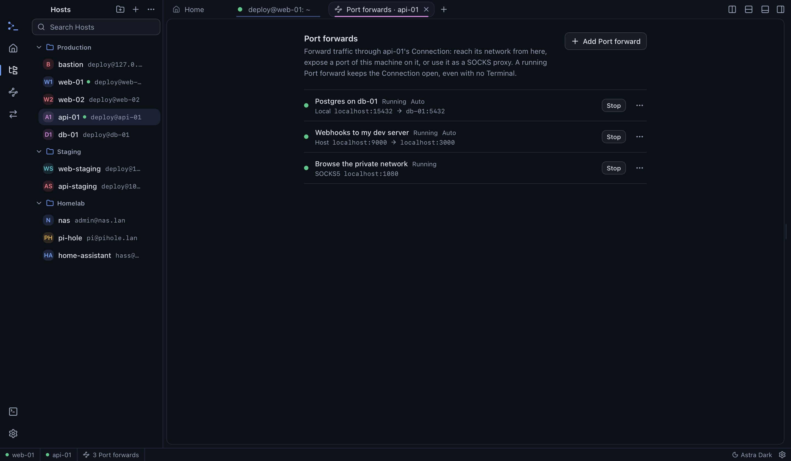

<div align="center">


# SSH Astra

A modern, good-looking SSH & SFTP client for Windows, macOS and Linux.

[](https://github.com/amemiya02/ssh-astra/actions/workflows/ci.yml)
[](https://github.com/amemiya02/ssh-astra/releases)
[](LICENSE)

[](https://tauri.app)

**English** · [简体中文](README.zh-CN.md)

<picture>
  <source media="(prefers-color-scheme: light)" srcset="docs/screenshots/main-light.png">
  
</picture>

</div>

## Features

- **Hosts**: groups, search, import from `~/.ssh/config`, Jump hosts.
- **Terminals**: tabs and split panes; xterm.js with WebGL rendering.
- **SFTP File panel**: follows your shell's `cd`. Has a transfer queue and drag-and-drop upload. Edited files save back to the server on their own.
- **Port forwards**: local, remote and SOCKS5; can start when you connect.
- **Security**: ssh-agent, keys, password and 2FA; secrets stay in the OS keychain; shares `known_hosts` with OpenSSH.
- **Reconnects** on its own after a dropped Connection.
- **Polish**: ⌘K command palette, light and dark themes, English and 简体中文, in-app updates.

<table>
  <tr>
    <td></td>
    <td></td>
  </tr>
  <tr>
    <td></td>
    <td></td>
  </tr>
</table>

## Install

Download from [Releases](https://github.com/amemiya02/ssh-astra/releases): `.msi` (Windows), universal `.dmg` (macOS), `.AppImage` / `.deb` (Linux).

> [!NOTE]
> The installers are not code-signed yet.
> - **macOS:** right-click the app and choose **Open** the first time.
> - **Windows:** click **More info → Run anyway**.

## Build from source

Requires Node.js 22+, pnpm, Rust stable and the [Tauri prerequisites](https://tauri.app/start/prerequisites/).

```bash
pnpm install
pnpm tauri dev      # run
pnpm tauri build    # package
```

## Contributing

Issues and PRs are welcome. [`CLAUDE.md`](CLAUDE.md) describes the project layout and conventions, and [`GLOSSARY.md`](GLOSSARY.md) the domain terms.

## License

[MIT](LICENSE)
