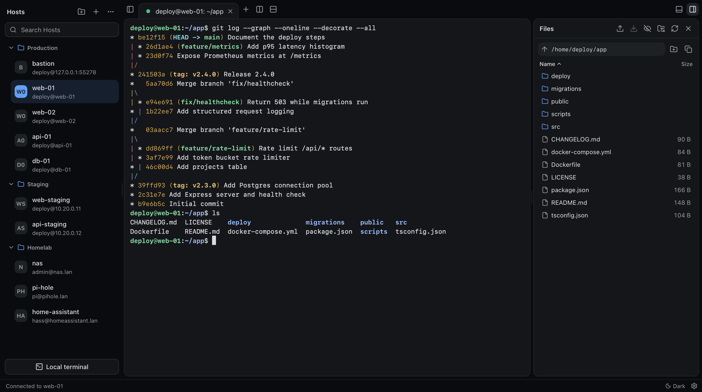
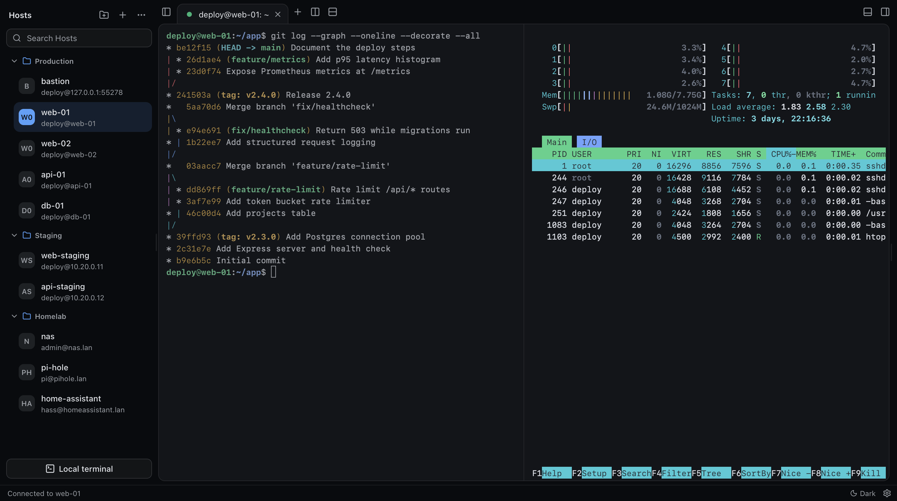
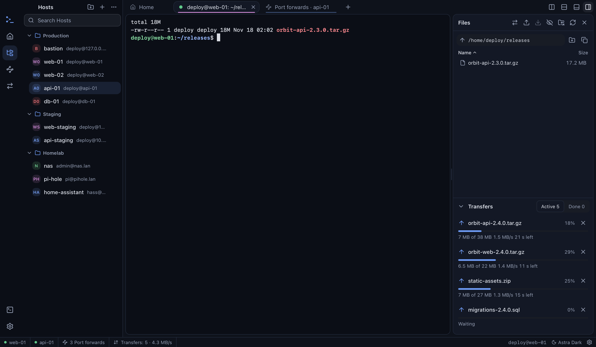
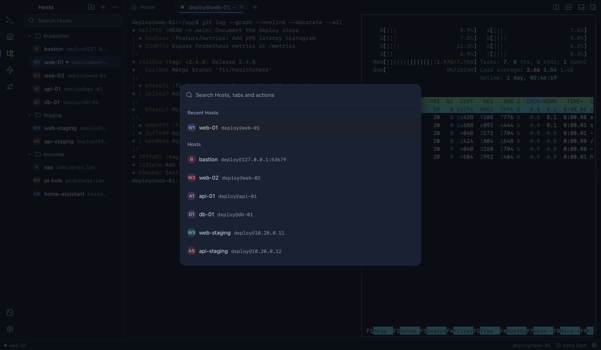
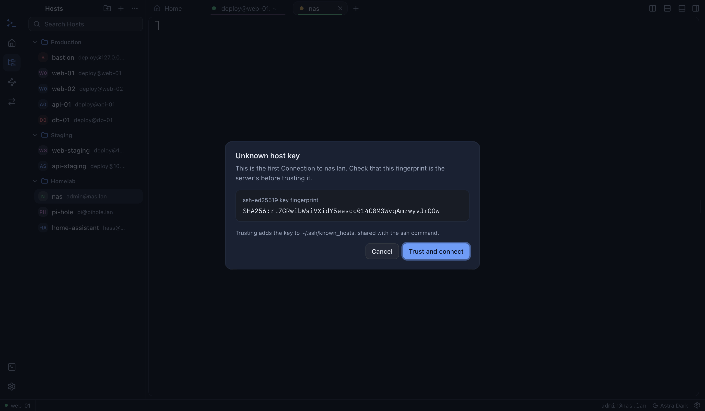
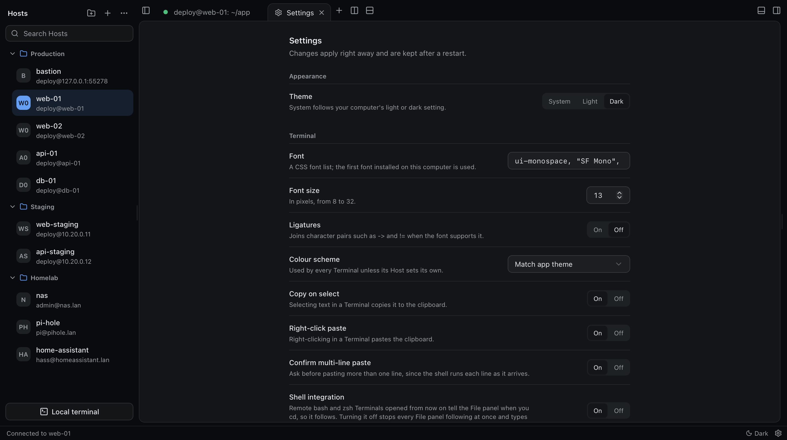

<div align="center">


# SSH Astra

**现代、美观、跨平台的 SSH / SFTP 客户端**

终端、文件、端口转发都在一个窗口里，界面安静，操作顺手。

[](https://github.com/amemiya02/ssh-astra/actions/workflows/ci.yml)
[](https://github.com/amemiya02/ssh-astra/releases)
[](https://github.com/amemiya02/ssh-astra/releases)
[](LICENSE)
[](https://github.com/amemiya02/ssh-astra/stargazers)


[](https://tauri.app)
[](https://www.rust-lang.org)
[](https://react.dev)
[](https://www.typescriptlang.org)

[下载](#-下载与安装) · [功能](#-功能) · [快捷键](#️-快捷键) · [从源码构建](#️-从源码构建) · [路线图](#️-路线图) · [参与贡献](#-参与贡献)

<br>

<picture>
  <source media="(prefers-color-scheme: light)" srcset="docs/screenshots/main-light.png">
  
</picture>

</div>

## ✨ 为什么是 SSH Astra

日常运维要的东西其实不多：**连上服务器、敲命令、传文件、开个隧道**。SSH Astra 只把这几件事做好，并且做得好看：

- 🪐 **一个窗口搞定**：终端旁边就是 SFTP 文件面板，`cd` 到哪，文件面板就跟到哪。
- 🔐 **不另起炉灶**：直接导入 `~/.ssh/config`，复用 `known_hosts` 和 ssh-agent；密码只放进系统钥匙串。
- ⚡ **原生而轻量**：Tauri 2 + Rust 的 SSH 内核（[russh](https://github.com/Eugeny/russh)），安装包只有几 MB，不是又一个 Electron。
- 🎨 **安静的设计**：深色 / 浅色主题、WebGL 渲染的终端、⌘K 命令面板，界面中英双语。
- 🧩 **开源免费**：MIT 协议，Windows、macOS、Linux 都能用。

## 📸 截图

<table>
  <tr>
    <td width="50%"><br><sub><b>分屏</b>：一个标签页里并排多个终端，左边看日志，右边跑 htop</sub></td>
    <td width="50%"><br><sub><b>传输队列</b>：拖进来就上传，并发、速度、剩余时间一目了然</sub></td>
  </tr>
  <tr>
    <td width="50%"><br><sub><b>端口转发</b>：本地 / 远程 / SOCKS5，连接时自动启动，状态栏实时可见</sub></td>
    <td width="50%"><br><sub><b>命令面板</b>：⌘K 搜 Host、开设置、执行任何操作</sub></td>
  </tr>
  <tr>
    <td width="50%"><br><sub><b>主机密钥校验</b>：首次连接展示指纹，与 OpenSSH 共用 known_hosts</sub></td>
    <td width="50%"><br><sub><b>设置</b>：每一项改完立即生效</sub></td>
  </tr>
</table>

## 🚀 功能

### Host 管理
- 分组（可嵌套）、拖拽排序、模糊搜索、最近连接
- **一键导入 `~/.ssh/config`**：支持 `Include`、`ProxyJump`、`IdentityFile`、`LocalForward` / `RemoteForward` / `DynamicForward`
- **跳板机**：任意层级的 Jump host 链，每一跳独立校验主机密钥
- Host 列表导入 / 导出（JSON，永远不含凭据）
- 每个 Host 可单独设置终端配色和默认目录

### 连接与认证
- 认证顺序：ssh-agent（Windows 支持 OpenSSH agent 与 Pageant）→ 私钥文件 → 密码 → keyboard-interactive（含二次验证）
- 密码和私钥口令存入**系统钥匙串**（macOS Keychain / Windows 凭据管理器 / Linux Secret Service），不写进任何配置文件
- 与 OpenSSH 共享 `~/.ssh/known_hosts`；主机密钥变化直接拒绝连接，不给“继续”按钮
- Keepalive 保活，断线后自动重连（指数退避），重连成功后在同一个终端里继续
- **仅连接（Connect only）**：不开终端，只为端口转发保持连接

### 终端
- 基于 xterm.js（WebGL 渲染），多标签 + 分屏，标签可拖动排序
- 搜索、链接点击、选中即复制、右键粘贴、多行粘贴确认
- 多套配色方案、字体与字号可调
- **Shell 集成**：自动识别远程 `cd`（OSC 7），不改动服务器上的任何 rc 文件
- 本地终端（使用系统默认 shell）

### 文件（SFTP）
- 每个远程终端配一个文件面板，**跟随终端的当前目录**
- 新建、重命名、删除（递归）、修改权限；隐藏文件开关、排序；上万文件的目录也流畅（虚拟列表）
- **传输队列**：上传 / 下载文件与文件夹，从系统文件管理器直接拖入；并发数可调，冲突时询问覆盖或跳过，可取消、可重试
- **远程编辑**：双击用本地默认编辑器打开，保存后自动传回服务器；大文件和二进制文件会先确认

### 端口转发
- 本地（`-L`）、远程（`-R`）、动态 SOCKS5（`-D`）
- 规则保存在 Host 上，可设为连接时自动启动；端口被占用、服务器拒绝等错误会清楚地告诉你原因

### 其他
- ⌘K / Ctrl+Shift+K 命令面板
- 深色 / 浅色 / 跟随系统主题，简体中文 / English
- 应用内自动更新（更新包经签名校验）

## 📦 下载与安装

前往 [**Releases**](https://github.com/amemiya02/ssh-astra/releases) 下载对应平台的安装包：

| 平台 | 安装包 |
| --- | --- |
| Windows 10 / 11 | `SSH.Astra_<版本>_x64-setup.exe` 或 `.msi` |
| macOS 11+（Intel 与 Apple Silicon） | `SSH.Astra_<版本>_universal.dmg` |
| Linux | `.AppImage`（通用）或 `.deb`（Debian / Ubuntu） |

> [!NOTE]
> 目前安装包**尚未做系统级代码签名**（Apple 公证 / Windows Authenticode），首次打开时系统会拦一下：
>
> - **macOS**：提示“无法验证开发者”时，在“访达”里右键点 SSH Astra → **打开**；或者执行
>   ```bash
>   xattr -dr com.apple.quarantine "/Applications/SSH Astra.app"
>   ```
> - **Windows**：SmartScreen 提示时，点 **更多信息** → **仍要运行**。
> - **Linux（AppImage）**：`chmod +x SSH.Astra_*.AppImage` 后直接运行。
>
> 应用内更新的包都经过独立的签名校验，不受影响。

> [!WARNING]
> 当前是 **v0.x 预览版**，功能已经可以日常使用，但配置格式和界面细节仍可能调整。欢迎试用并[反馈问题](https://github.com/amemiya02/ssh-astra/issues)。

## 🧭 快速上手

1. **添加 Host**：点 Host 列表右上角的 **+**，或在空列表上选 **从 ~/.ssh/config 导入**。
2. **连接**：双击 Host（或选中后按 Enter）。第一次连接会让你确认主机密钥指纹。
3. **传文件**：打开右侧文件面板（工具栏右上角），把文件从系统文件管理器拖进去即可上传。
4. **开隧道**：在 Host 的右键菜单里打开 **端口转发**，添加规则后点 **启动**。
5. **找任何东西**：按 <kbd>⌘</kbd> <kbd>K</kbd>（Windows / Linux：<kbd>Ctrl</kbd> <kbd>Shift</kbd> <kbd>K</kbd>）。

## ⌨️ 快捷键

在 Windows / Linux 上，应用快捷键统一用 <kbd>Ctrl</kbd>+<kbd>Shift</kbd>，把单独的 <kbd>Ctrl</kbd>+字母 留给 shell（比如 `Ctrl+K`、`Ctrl+F`）。

| 操作 | macOS | Windows / Linux |
| --- | --- | --- |
| 新建标签页 | <kbd>⌘</kbd> <kbd>T</kbd> | <kbd>Ctrl</kbd> <kbd>Shift</kbd> <kbd>T</kbd> |
| 关闭当前窗格 | <kbd>⌘</kbd> <kbd>W</kbd> | <kbd>Ctrl</kbd> <kbd>Shift</kbd> <kbd>W</kbd> |
| 向右分屏 | <kbd>⌘</kbd> <kbd>D</kbd> | <kbd>Ctrl</kbd> <kbd>Shift</kbd> <kbd>E</kbd> |
| 向下分屏 | <kbd>⌘</kbd> <kbd>⇧</kbd> <kbd>D</kbd> | <kbd>Ctrl</kbd> <kbd>Shift</kbd> <kbd>O</kbd> |
| 下一个 / 上一个标签页 | <kbd>⌘</kbd> <kbd>⇧</kbd> <kbd>]</kbd> / <kbd>[</kbd> | <kbd>Ctrl</kbd> <kbd>PgDn</kbd> / <kbd>PgUp</kbd> |
| 切换标签页（通用） | <kbd>Ctrl</kbd> <kbd>Tab</kbd> / <kbd>Ctrl</kbd> <kbd>Shift</kbd> <kbd>Tab</kbd> | 同左 |
| 移动标签页 | <kbd>Ctrl</kbd> <kbd>Shift</kbd> <kbd>PgDn</kbd> / <kbd>PgUp</kbd> | 同左 |
| 在窗格间切换 | <kbd>⌘</kbd> <kbd>]</kbd> / <kbd>[</kbd> | <kbd>Ctrl</kbd> <kbd>Shift</kbd> <kbd>N</kbd> / <kbd>P</kbd> |
| 跳到第 1–8 个 / 最后一个标签页 | <kbd>⌘</kbd> <kbd>1</kbd>…<kbd>8</kbd> / <kbd>9</kbd> | <kbd>Alt</kbd> <kbd>1</kbd>…<kbd>8</kbd> / <kbd>9</kbd> |
| 命令面板 | <kbd>⌘</kbd> <kbd>K</kbd> | <kbd>Ctrl</kbd> <kbd>Shift</kbd> <kbd>K</kbd> |
| 设置 | <kbd>⌘</kbd> <kbd>,</kbd> | <kbd>Ctrl</kbd> <kbd>Shift</kbd> <kbd>,</kbd> |
| 终端内搜索 | <kbd>⌘</kbd> <kbd>F</kbd> | <kbd>Ctrl</kbd> <kbd>Shift</kbd> <kbd>F</kbd> |

## 🏗️ 技术架构

```text
┌──────────────────────── SSH Astra（Tauri 2）────────────────────────┐
│  前端  React 19 · TypeScript · Vite · Tailwind CSS v4 · shadcn/ui    │
│        xterm.js（WebGL）· Zustand · i18next                          │
│                      │  Tauri IPC：命令 + Channel 流                  │
│  桥接  src-tauri：薄薄一层 Tauri 命令，不含业务逻辑                      │
│                      │                                               │
│  内核  sshastra-core（纯 Rust，不依赖 Tauri）                          │
│        russh / russh-sftp · 连接复用 · 自动重连 · 端口转发 · SOCKS5     │
│        传输队列 · 远程编辑 · known_hosts · 钥匙串 · ssh_config 解析     │
└─────────────────────────────────────────────────────────────────────┘
```

- **内核与界面分离**：所有 SSH / SFTP 逻辑都在 `sshastra-core` 里，可以脱离 Tauri 单独测试（CI 会检查它不依赖 Tauri）。
- **流式数据走 Channel**：终端输出、传输进度、连接状态都由后端推送，前端不轮询。
- **同一 Host 共用一个连接**：终端、文件面板、传输、端口转发复用同一条 SSH 连接，最后一个使用者离开时才断开。

选型理由见 [ADR 0001：Tauri + Rust SSH 内核](docs/adr/0001-tauri-and-rust-ssh-core.md)。

## 🛠️ 从源码构建

**环境要求**

- [Node.js](https://nodejs.org) 22+ 与 [pnpm](https://pnpm.io)（版本见 `package.json` 的 `packageManager`，推荐 `corepack enable`）
- [Rust](https://rustup.rs) stable
- 各平台的 [Tauri 前置依赖](https://tauri.app/start/prerequisites/)（Linux 需要 WebKitGTK 等系统库）

```bash
git clone https://github.com/amemiya02/ssh-astra.git
```
```bash
cd ssh-astra && pnpm install
```
```bash
pnpm tauri dev
```

打包安装包：

```bash
pnpm tauri build
```

### 测试

| 命令 | 内容 |
| --- | --- |
| `pnpm lint && pnpm typecheck && pnpm test` | 前端 lint、类型检查、Vitest 单元测试 |
| `cd src-tauri && cargo test --workspace` | Rust 单元测试 + **Docker OpenSSH 集成测试**（有 Docker 时自动运行） |
| `pnpm e2e:build && pnpm e2e` | WebdriverIO 端到端冒烟测试（真实应用 + Docker sshd） |
| `pnpm e2e:build && pnpm screenshots` | 重新生成本 README 的截图 |

集成测试会用 Docker Compose 拉起一组 OpenSSH 容器（跳板机、仅密钥认证、keyboard-interactive、会断线的服务器……），每个检出目录使用独立的 Compose 项目，互不干扰。

## 🗺️ 路线图

- [x] Host 管理、`~/.ssh/config` 导入、跳板机
- [x] 多标签 / 分屏终端、Shell 集成
- [x] SFTP 文件面板、传输队列、远程编辑
- [x] 端口转发（本地 / 远程 / SOCKS5）
- [x] 断线自动重连、系统钥匙串
- [x] 自动更新与跨平台发布
- [ ] macOS 公证与 Windows 代码签名
- [ ] X11 转发
- [ ] 串口、Telnet、Mosh
- [ ] RDP / VNC
- [ ] 多设备同步 Host 配置

有想要的功能？欢迎在 [Issues](https://github.com/amemiya02/ssh-astra/issues) 里提出。

## 🤝 参与贡献

非常欢迎 Issue 和 Pull Request！开始之前可以先看看：

- [`PRODUCT.md`](PRODUCT.md)：产品定位与原则
- [`DESIGN.md`](DESIGN.md)：设计规范（颜色、字体、间距、组件）
- [`GLOSSARY.md`](GLOSSARY.md)：领域术语（Host、Connection、Terminal、Port forward……），代码和文案都按它来
- [`CLAUDE.md`](CLAUDE.md)：项目结构与开发约定

提交 PR 前请确认 `pnpm lint`、`pnpm typecheck`、`pnpm test`、`cargo fmt --all --check`、`cargo clippy --workspace --all-targets -- -D warnings` 和 `cargo test --workspace` 都能通过。

## 🙏 致谢

SSH Astra 站在这些优秀项目的肩膀上：
[Tauri](https://tauri.app) ·
[russh](https://github.com/Eugeny/russh) ·
[xterm.js](https://xtermjs.org) ·
[React](https://react.dev) ·
[shadcn/ui](https://ui.shadcn.com) ·
[Tailwind CSS](https://tailwindcss.com) ·
[Zustand](https://zustand.docs.pmnd.rs) ·
[Lucide](https://lucide.dev)

## 📄 许可证

[MIT](LICENSE) © 2026 amemiya02

<div align="center">
<br>
<sub>如果 SSH Astra 对你有帮助，点个 ⭐ 就是最好的支持。</sub>
</div>
