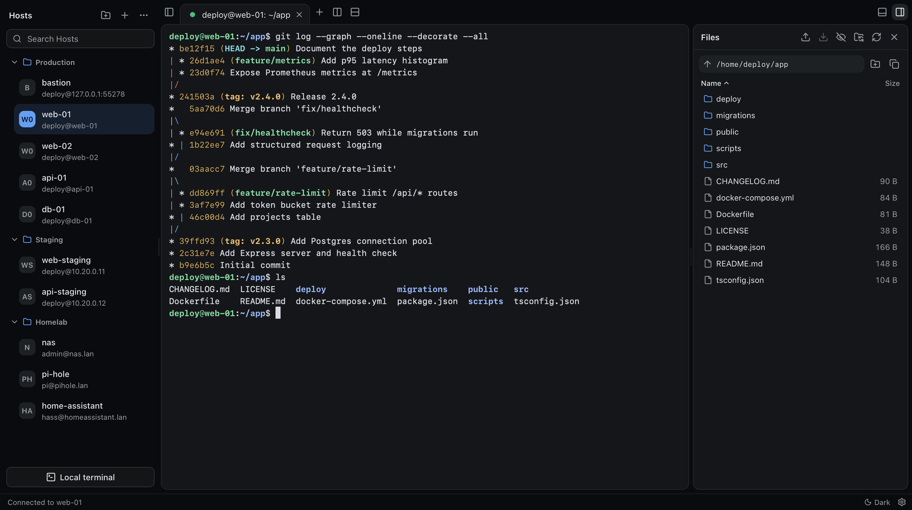
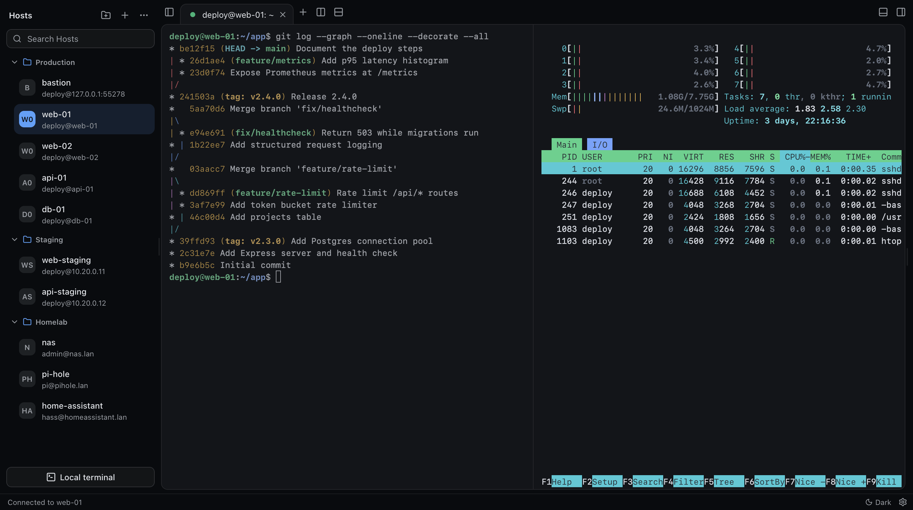
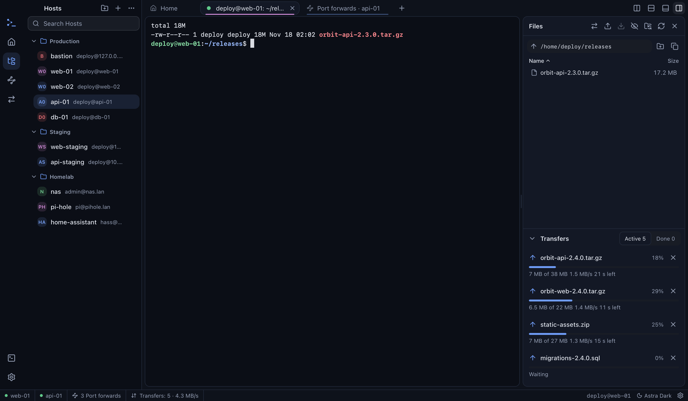
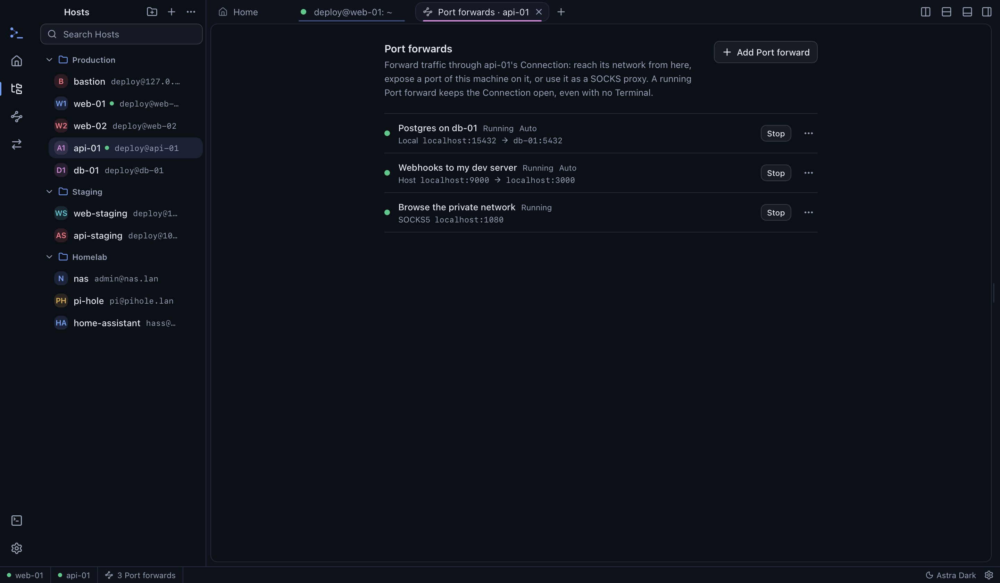
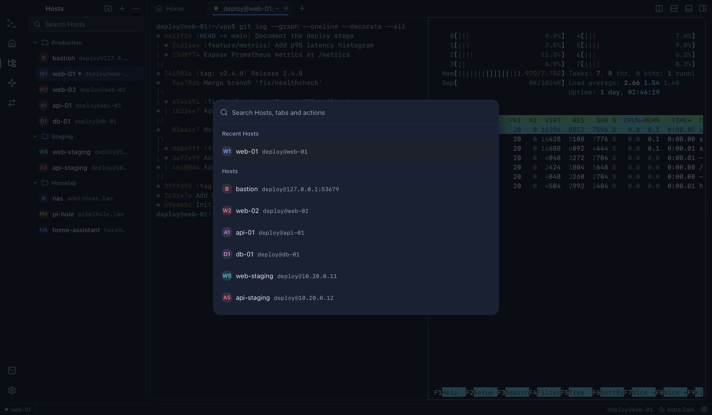

<div align="center">


# SSH Astra

现代、美观的跨平台 SSH / SFTP 客户端，支持 Windows、macOS、Linux。

[](https://github.com/amemiya02/ssh-astra/actions/workflows/ci.yml)
[](https://github.com/amemiya02/ssh-astra/releases)
[](LICENSE)

[](https://tauri.app)

[English](README.md) · **简体中文**

<picture>
  <source media="(prefers-color-scheme: light)" srcset="docs/screenshots/main-light.png">
  
</picture>

</div>

## 功能

- **Host 管理**：分组、搜索，导入 `~/.ssh/config`，跳板机
- **终端**：多标签 + 分屏，xterm.js WebGL 渲染
- **SFTP 文件面板**：跟随终端 `cd`；传输队列、拖拽上传；远程编辑，保存后自动传回
- **端口转发**：本地 / 远程 / SOCKS5，可随连接自动启动
- **安全**：ssh-agent、私钥、OpenSSH 用户证书、密码和二次验证；凭据存系统钥匙串；与 OpenSSH 共用 `known_hosts`
- **断线自动重连**
- **系统通知**会在窗口处于后台时提示批量传输结束、重连失败和 Terminal 程序发出的通知。可在**设置 → 通知**中按类别开关。
- **体验**：⌘K 命令面板，深色 / 浅色主题，中英双语，应用内更新

<table>
  <tr>
    <td></td>
    <td></td>
  </tr>
  <tr>
    <td></td>
    <td></td>
  </tr>
</table>

## 终端快捷键

| 操作 | macOS | Windows 和 Linux |
| --- | --- | --- |
| 增大字号 | `⌘+` | `Ctrl++` |
| 减小字号 | `⌘-` | `Ctrl+-` |
| 用滚轮缩放字号 | 按住 Command 或 Control，在终端上滚动 | 按住 Ctrl，在终端上滚动 |

缩放会保存所有终端共用的字号，范围为 8–32 像素。增大字号的快捷键也支持 `=` 键。

### 终端日志

可从标签菜单或命令面板开始或停止记录终端日志。只要标签中有一个分屏正在记录，标签上就会显示标记。在**设置 → 终端**中可选择保存文件夹，也可为每个新开的终端启用自动记录。自动记录默认关闭。

文件以 Host 名称（本地终端为 `Local`）和 UTC 开始时间命名，使用 UTF-8 编码。远程终端重连后继续写入同一文件。日志保留纯文本输出，包括 shell 回显的命令。默认日志保存在 SSH Astra 数据目录下的 `terminal-logs` 文件夹中。

### 终端录制

可从终端右键菜单、标签菜单或命令面板选择**开始终端录制**或**停止终端录制**。只要标签中有终端正在录制，标签上就会显示录制标记。终端日志与录制可同时运行。

`.cast` 文件使用 asciicast v2 格式，保存带时间的终端输出和终端大小变化。录制文件与终端日志使用相同的命名规则和**终端输出文件夹**设置。使用 `asciinema play /path/to/recording.cast` 回放。

### 终端协议支持

SSH Astra 使用 xterm.js 6.0.0。

- **同步刷新（DECSET 2026）**已支持。xterm.js 会积累屏幕重绘请求，等程序复位该模式后一次刷新。如果程序没有复位，xterm.js 会在一秒后恢复刷新。[6.0.0 发布说明](https://github.com/xtermjs/xterm.js/releases/tag/6.0.0) · [6.0.0 渲染服务源码](https://github.com/xtermjs/xterm.js/blob/6.0.0/src/browser/services/RenderService.ts#L320-L352)
- **Kitty 键盘协议**在 6.0.0 中尚不支持。该版本的 CSI 处理器缺少 Kitty 键盘协议协商，键盘编码器使用传统转义序列。[6.0.0 CSI 处理器源码](https://github.com/xtermjs/xterm.js/blob/6.0.0/src/common/InputHandler.ts#L219-L268) · [6.0.0 键盘编码器源码](https://github.com/xtermjs/xterm.js/blob/6.0.0/src/common/input/Keyboard.ts)
- **Terminal 程序通知**支持 iTerm2 的 OSC 9 和 rxvt 的 OSC 777 `notify`。每个 Terminal 每秒最多发送一条。[转义序列格式](https://github.com/wezterm/wezterm/blob/main/docs/escape-sequences.md)

## 安装

从 [Releases](https://github.com/amemiya02/ssh-astra/releases) 下载：`.msi`（Windows）、通用 `.dmg`（macOS）、`.AppImage` / `.deb`（Linux）。

> [!NOTE]
> 安装包暂未做代码签名：
> - **macOS**：首次打开请右键点应用 → **打开**。
> - **Windows**：SmartScreen 提示时点 **更多信息 → 仍要运行**。

## 从源码构建

需要 Node.js 22+、pnpm、Rust stable 以及 [Tauri 前置依赖](https://tauri.app/start/prerequisites/)。

```bash
pnpm install
pnpm tauri dev      # 运行
pnpm tauri build    # 打包
```

## 日志与诊断

在**设置 → 诊断**中打开日志文件夹，也可在命令面板执行**打开日志文件夹**。各平台的默认位置如下。

- macOS — `~/Library/Logs/dev.sshastra.app/`
- Linux — `$XDG_DATA_HOME/dev.sshastra.app/logs/`（通常是 `~/.local/share/dev.sshastra.app/logs/`）
- Windows — `%LOCALAPPDATA%\dev.sshastra.app\logs\`

SSH Astra 保留四个应用日志文件，每个最多 1 MiB，以及最近五份 Rust 崩溃报告。日志记录应用启动和版本、SSH 连接与认证步骤、重连、端口转发、传输、远程编辑上传、主机与设置文件错误、更新检查和界面未捕获错误。崩溃报告包含错误类别和源代码位置。本地日志保留主机名称、地址与 SSH 用户名。

诊断日志不包含终端输入和输出、密码、密钥口令、私钥内容、剪贴板内容或原始界面错误消息与堆栈。**复制诊断信息**会复制应用版本、操作系统、架构和脱敏后的日志，其中主机名称、地址和用户名、跳板机、端口转发目标、密钥路径、系统用户名、主目录和 IP 地址均以代号替换。所有日志均保存在本机，SSH Astra 不会上传日志。

## 参与贡献

欢迎提 Issue 和 PR。项目结构与开发约定见 [`CLAUDE.md`](CLAUDE.md)，领域术语见 [`GLOSSARY.md`](GLOSSARY.md)。

在 macOS 上启动 Docker 后运行 `pnpm performance`，即可重跑[性能基线](docs/baseline.md)。

## 许可证

[MIT](LICENSE)
